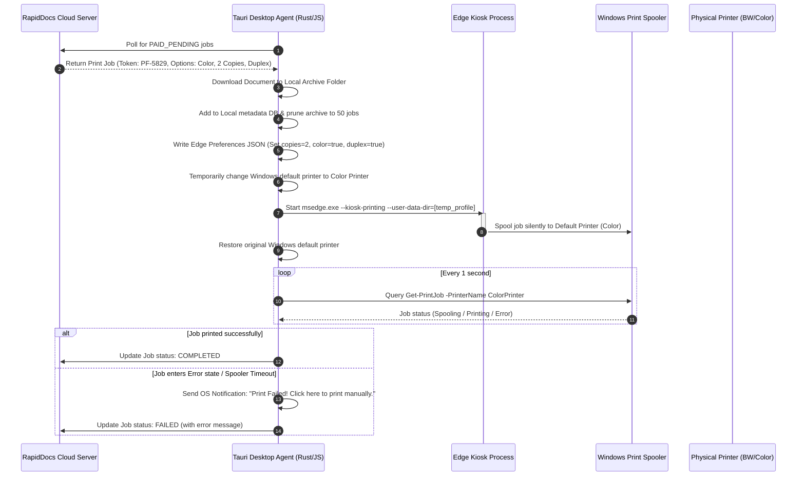

# RapidDocs SaaS: Proposed Chromium-Based Print Automation Architecture

This document proposes a robust, browser-driven printing and monitoring architecture for the **RapidDocs Desktop Agent**. It replaces the flaky native/CLI print utilities (`PDFtoPrinter.exe`, `System.Drawing`, print verbs) with an automated, isolated Microsoft Edge print session, coupled with real-time print queue monitoring and a local job archiving fallback.

---

## 1. Why Browser-Based Printing?

The current printing mechanism relies on command-line utilities and .NET GDI+ APIs (`System.Drawing`), which suffer from several limitations:
1. **Font & Layout Rendering Errors**: CLI-based PDF rendering engines often miss embedded fonts or scale vector layers incorrectly, leading to distorted physical printouts.
2. **Unsupported Image Formats**: GDI+ throws generic `Out of Memory` or `ArgumentNull` exceptions when reading modern PNG/WebP color spaces or metadata headers.
3. **No Granular Controls**: Custom configurations like duplexing, page collating, and copies are difficult to specify uniformly across different printer drivers via command-line flags.

**The Solution**: Every Windows 10/11 machine has Microsoft Edge pre-installed. Since Edge is based on Chromium, it possesses a highly advanced, enterprise-grade PDF/HTML rendering and printing engine. By automating Edge in a hidden window, we guarantee **100% rendering accuracy** (matching what the customer saw on their screen) and get access to rich print configurations.

---

## 2. High-Level Architecture Flow

The following sequence diagram illustrates the automated printing lifecycle, including configuration injection, printer switching, and queue tracking:



---

## 3. Core Capabilities & Technical Design

### A. Print Settings via Chromium Preferences
Chromium (and Edge) stores "sticky" print preview configurations inside a JSON file named `Preferences` under the User Data directory (e.g. `Default\Preferences`).
Before launching the Edge print process, our Tauri agent creates an isolated profile folder and pre-writes this JSON file. This forces the browser to apply the customer's settings instantly.

#### The `Preferences` JSON Structure:
```json
{
  "printing": {
    "print_preview_sticky_settings": {
      "appState": "{\"version\":2,\"selectedDestinationId\":\"HP Smart Tank 580\",\"recentDestinations\":[{\"id\":\"HP Smart Tank 580\",\"origin\":\"local\",\"account\":\"\",\"displayName\":\"HP Smart Tank 580\"}],\"isColorEnabled\":true,\"isDuplexEnabled\":true,\"isCollateEnabled\":true,\"copies\":2,\"isLandscapeEnabled\":false}"
    }
  }
}
```

### B. Dynamic Printer Selection (Default Switching)
Since Chromium's `--kiosk-printing` mode strictly routes prints to the current system default printer, we use the Windows Script Host COM object (`WScript.Network`) to temporarily swap the default printer to the target printer (Color vs B&W) before launching Edge, and swap it back immediately after the print is spooled. This is extremely fast (<50ms) and does not disrupt the user.

### C. Off-Screen / Hidden Browser Launch
To prevent showing a full-screen browser window to the shop owner, we launch Edge in **Kiosk Mode** (which hides toolbars and margins) but force its position to be off-screen.
* **Flags Used**:
  * `--kiosk-printing`: Bypasses the Print Preview window, sending the job directly to the printer.
  * `--user-data-dir`: Directs Edge to load our isolated profile with the custom preferences.
  * `--window-position=-32000,-32000`: Positions the window completely outside the user's monitor space.
  * `--window-size=10,10`: Keeps the window size minuscule, saving rendering memory.
  * `--no-first-run --no-default-browser-check`: Bypasses welcome modals.

### D. Spooler Queue Monitoring State Machine
The Tauri agent starts polling the print queue via PowerShell's `Get-PrintJob` as soon as Edge is launched. The job is identified by checking if the `DocumentName` contains the job's unique token (e.g., `PF-XXXX`).

* **SPOOLING**: Waiting for the job to appear in `Get-PrintJob` (Timeout: 10s).
* **PRINTING**: Job appears in the queue. We report progress (`PagesPrinted` / `TotalPages`) back to the cloud.
* **ERROR_DETECTED**: If `JobStatus` matches `Error`, `Offline`, `PaperOut`, or `UserActionRequired`, we capture the failure.
* **COMPLETED**: If the job disappears from the queue without having entered an error state, we mark the job as successfully printed.

---

## 4. Local Job Archive (Last 50 Jobs Fallback)

To ensure the shop owner can fulfill paid printing jobs in case of automation failures, the Desktop Agent will manage a local database of the last 50 jobs.

1. **Storage Location**: `%APPDATA%\RapidDocsAgent\jobs_archive\`
2. **Metadata Store**: A local JSON file `jobs_archive.json` listing:
   - Job Token (`PF-XXXX`)
   - Document ID & File path
   - Configuration options (copies, color, duplex, paper)
   - Status (Auto-Printed / Failed / Printed Manually)
   - Customer Details
   - Timestamp
3. **Rolling Pruning**:
   - When a job is fetched, the file is saved permanently in the archive folder.
   - A worker checks if the folder has >50 files. If so, it deletes the oldest file and removes its metadata entry.
4. **UI Console**:
   - The Desktop Agent UI displays a dedicated "Local Job Archive" tab showing these 50 jobs.
   - The operator can click **"Print Manually"** (which opens the file in the default system viewer with a print dialog) or **"Retry Auto-Print"**.

---

## 5. Prototype Implementation

### Rust Tauri Backend Mappings (`lib.rs`)

```rust
use std::process::Command;
use std::fs;
use std::path::Path;

// Helper to write preferences and launch Edge off-screen
#[tauri::command]
fn print_via_edge(
    file_path: String,
    printer_name: String,
    copies: i32,
    is_color: bool,
    is_duplex: bool,
    is_collate: bool,
    job_token: String
) -> Result<String, String> {
    #[cfg(target_os = "windows")]
    {
        // 1. Setup Temp Profile & write Preferences
        let temp_dir = std::env::temp_dir();
        let profile_dir = temp_dir.join("rapiddocs-edge-profile");
        let default_dir = profile_dir.join("Default");
        fs::create_dir_all(&default_dir).map_err(|e| e.to_string())?;

        // Format appState inside Preferences
        let app_state = serde_json::json!({
            "version": 2,
            "selectedDestinationId": printer_name,
            "recentDestinations": [{
                "id": printer_name,
                "origin": "local",
                "account": "",
                "displayName": printer_name
            }],
            "isColorEnabled": is_color,
            "isDuplexEnabled": is_duplex,
            "isCollateEnabled": is_collate,
            "copies": copies
        });
        
        let prefs = serde_json::json!({
            "printing": {
                "print_preview_sticky_settings": {
                    "appState": serde_json::to_string(&app_state).unwrap()
                }
            }
        });

        let prefs_path = default_dir.join("Preferences");
        fs::write(prefs_path, serde_json::to_string_pretty(&prefs).unwrap()).map_err(|e| e.to_string())?;

        // 2. Call PowerShell print harness
        let ps_script = format!(
            r#"
            $net = New-Object -ComObject WScript.Network
            $oldPrinter = Get-CimInstance -ClassName Win32_Printer | Where-Object {{ $_.Default -eq $true }}
            
            # Switch default printer
            if ($oldPrinter.Name -ne '{printer_name}') {{
                $net.SetDefaultPrinter('{printer_name}')
            }}

            # Launch Edge
            $edge = "${{env:ProgramFiles(x86)}}\Microsoft\Edge\Application\msedge.exe"
            $args = @(
                "--kiosk-printing",
                "--user-data-dir={profile_dir}",
                "--no-first-run",
                "--no-default-browser-check",
                "--window-position=-32000,-32000",
                "--window-size=10,10",
                "{file_path}"
            )
            
            $proc = Start-Process -FilePath $edge -ArgumentList $args -PassThru -WindowStyle Hidden
            
            # Monitor Spooling
            $spooled = $false
            for ($i = 0; $i -lt 15; $i++) {{
                Start-Sleep -Seconds 1
                $jobs = Get-PrintJob -PrinterName '{printer_name}' -ErrorAction SilentlyContinue
                if ($jobs | Where-Object {{ $_.DocumentName -like '*{job_token}*' -or $_.DocumentName -like '*{file_name}*' }}) {{
                    $spooled = $true
                    break
                }}
            }}

            # Close browser once it sends job to spooler
            Start-Sleep -Seconds 2
            Stop-Process -Id $proc.Id -Force -ErrorAction SilentlyContinue

            # Restore original default printer
            if ($oldPrinter) {{
                $net.SetDefaultPrinter($oldPrinter.Name)
            }}
            
            if ($spooled) {{ "SPOOL_SUCCESS" }} else {{ "SPOOL_TIMEOUT" }}
            "#,
            printer_name = printer_name,
            profile_dir = profile_dir.to_string_lossy(),
            file_path = file_path,
            job_token = job_token,
            file_name = Path::new(&file_path).file_name().unwrap().to_string_lossy()
        );

        let output = Command::new("powershell")
            .args(&["-Command", &ps_script])
            .output();

        match output {
            Ok(out) => {
                let stdout = String::from_utf8_lossy(&out.stdout).trim().to_string();
                if stdout.contains("SPOOL_SUCCESS") {
                    Ok("Job spooled successfully via Microsoft Edge.".to_string())
                } else {
                    Err(format!("Edge Print Spooling Failed: {}", stdout))
                }
            }
            Err(e) => Err(format!("Failed to execute print script: {}", e))
        }
    }
    #[cfg(not(target_os = "windows"))]
    Ok("Simulation: Edge print completed.".to_string())
}
```

### TypeScript Job Archive Management (`archive.ts`)

```typescript
import { invoke } from "@tauri-apps/api/core";

export interface ArchivedJob {
  id: string;
  token: string;
  fileName: string;
  localPath: string;
  isColor: boolean;
  isDuplex: boolean;
  copies: number;
  price: number;
  timestamp: string;
  status: "SUCCESS" | "FAILED" | "MANUAL";
}

// Stores the document and maintains the rolling 50-job archive
export async function archiveJob(job: any, fileUrl: string): Promise<string> {
  const archivePath = "jobs_archive";
  
  // 1. Download file via Tauri backend or fetch
  const localFileName = `${job.token}_${job.document.originalName}`;
  const localPath = `C:\\Users\\Asus\\AppData\\Roaming\\RapidDocsAgent\\jobs_archive\\${localFileName}`;
  
  // 2. Load jobs_archive.json, append new job metadata
  let db: ArchivedJob[] = [];
  try {
    const dbContent = await invoke<string>("read_archive_db");
    db = JSON.parse(dbContent);
  } catch {
    // DB doesn't exist yet
  }
  
  // Check and push
  db.unshift({
    id: job.id,
    token: job.token,
    fileName: job.document.originalName,
    localPath: localPath,
    isColor: job.isColor,
    isDuplex: job.isDuplex,
    copies: job.copies,
    price: job.price,
    timestamp: new Date().toISOString(),
    status: "SUCCESS"
  });

  // 3. Roll out older files if count > 50
  if (db.length > 50) {
    const removedJobs = db.splice(50);
    for (const oldJob of removedJobs) {
      await invoke("delete_local_file", { path: oldJob.localPath });
    }
  }

  // 4. Save metadata back to DB
  await invoke("save_archive_db", { content: JSON.stringify(db) });
  
  return localPath;
}
```

---

## 6. Premium UI Layout for Shop Owners (Local Job Archive)

Below is the proposed layout design to list these 50 stored jobs in the Tauri agent dashboard. It allows immediate recovery, folder exploration, and one-click manual printing:

```
+---------------------------------------------------------------------------------------------------------------+
|  RapidDocs Agent  [LIVE - ONLINE]                                                         Today: ₹1,420.00    |
+---------------------------------------------------------------------------------------------------------------+
|  [ Printer Mappings ]         [ LOCAL JOB ARCHIVE (Last 50 Paid Jobs) ]                                      |
|  B&W: Canon LBP2900           Search Token or File...                                       [ Open Archive Folder ] |
|  Color: HP Smart Tank 580     +-------------+-----------------------+---------+--------+---------+------------+
|                               | Token       | Document Name         | Type    | Price  | Status  | Actions    |
|  [ Settings ]                 +-------------+-----------------------+---------+--------+---------+------------+
|  B&W Rate: ₹0.15              | PF-KT97A4   | resume_june2026.pdf   | B&W (2) | ₹10.00 | Success | [Open] [🔄] |
|  Color Rate: ₹0.75            | PF-KM1124   | family_photo_4k.png   | Col (1) | ₹15.00 | Failed  | [Open] [🔄] |
|                               | PF-KB4402   | rent_agreement.docx   | B&W (4) | ₹20.00 | Manual  | [Open] [🔄] |
|  [ System Logs ]              | PF-KA5910   | ticket_mumbai.pdf     | B&W (1) | ₹5.00  | Success | [Open] [🔄] |
|  12:05 Job PF-KT97A4 sent     +-------------+-----------------------+---------+--------+---------+------------+
|  12:10 Printer error spooled  | Actions Legend:                                                               |
|  12:10 Push Alert triggered   | [Open] Opens the downloaded document in the system default reader (for manual print).|
|  12:11 Default restored       | [🔄]   Re-spools the job to the default printer using browser automation.      |
+---------------------------------------------------------------------------------------------------------------+
```

---

> [!TIP]
> **Dynamic Routing Optimization**: If a customer requests a color job but the designated color printer is offline or lacks paper, the system can automatically display a warning toast to the operator and suggest routing the job to an alternative printer with a single click.
