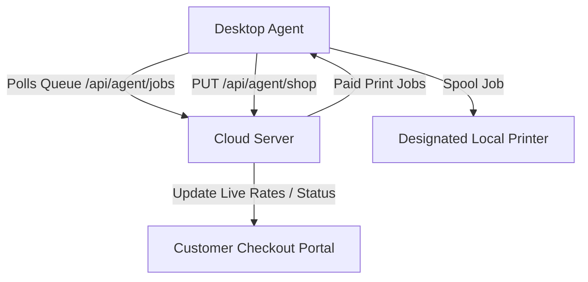

# PrintFlow Desktop Agent Walkthrough

The PrintFlow Desktop Agent is an ultra-lightweight client that connects local hardware printers to the cloud print queue. Since the host environment is not pre-installed with Rust compiler toolchains, the Desktop Agent has been engineered with a **dual-mode runtime strategy**:
1. **Native Client Mode (Tauri 2.x)**: When compiled as an `.exe`, it uses native Rust system commands for local hardware discovery and shell-spool printing.
2. **Browser Simulation Mode (Vite Preview)**: When loaded inside any standard web browser, it mocks native hardware layer calls, allowing full operator dashboard simulation, rate synchronization, and job queue testing.

---

## 🚀 How to Launch the Desktop Agent

You can start the Desktop Agent immediately on your development machine:

1. Open a terminal and run the agent dev server:
   ```bash
   cd agent
   npm run dev
   ```
2. Open your web browser and navigate to:
   ```
   http://localhost:1420/
   ```

---

## 🔑 Operator Authentication
When the agent starts, it prompts for the Operator Credentials:
- **Server URL**: `http://localhost:3000` (defaults to local cloud server, customizable)
- **Operator Email**: `owner@test.com`
- **Security Password**: `owner123`

Upon clicking **"Establish Cloud Link"**, the client authenticates and saves the secure session token locally (`localStorage` in simulation, or `config.json` inside the user config folder in native mode).

---

## 🎛️ Terminal Dashboard Features

Once logged in, the agent displays a fully-featured dashboard:



### 1. Hardware Printer Mapping
Discovers installed printers on the system. In browser simulation, it provides pre-populated fallbacks:
- **HP LaserJet Pro M402 (B&W)**
- **Epson L3110 Series (Color)**
- **Canon LBP2900 B&W**
- **Microsoft Print to PDF**

### 2. Live Rate Synchronization
Operators can adjust rates dynamically (e.g. B&W to ₹0.20, Color to ₹0.80) and click **"Save & Sync Rates"** to push updates to the cloud database.

### 3. Connection Status Control
Operators can toggle **"Go Live / Go Offline"** in one click. Toggling live instantly registers the terminal's status as `ONLINE` in the database, automatically enabling the customer checkout portal.

### 4. Diagnostic System Console
Shows real-time status statements:
- `[12:00:00] Initializing PrintFlow Agent (Simulation)...`
- `[12:00:04] Discovered 4 printers`
- `[12:00:15] Connected to shop dashboard: Test Xerox`
- `[12:01:00] Polling print jobs...`
- `[12:01:10] Spooling job PF-A9B2 to HP LaserJet Pro M402...`

---

## 🧪 Verifying End-to-End Spool Flow
1. Open the Customer Portal at `http://localhost:3000/point/test-xerox`. Notice it is fully online and displays B&W: ₹0.20 and Color: ₹0.80.
2. Upload a document and proceed to payment.
3. Click "Simulate Payment Success" on the tracker screen.
4. Watch the **Desktop Agent console** detect the paid job, download the binary stream, transition its status to `PENDING` -> `PRINTING` -> `COMPLETED`, and increment the printer counter!
